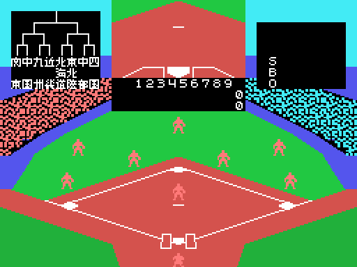

# The game

*Exciting Baseball* is the Japanese high-school baseball tournament (the Japanese title,
*Nessen Koushien*, means "the battle of Koshien"). It is played against the computer or
between two players, and the screen is the field seen from behind the batter: top left,
the tournament bracket; in the middle, a **window** showing the pitch close up or the
signs; on the right, the count of strikes, balls and outs. The tournament is in
[The tournament](THE-TOURNAMENT.html), and a whole game in [The plays](THE-PLAYS.html).

Every GIF on this site is the ROM **running in openMSX** (a Japanese MSX1, at 60 frames
per second): on every frame the VRAM and the VDP registers are logged, and
`tools/vdp.py` paints them.

## The controls

Each player has a direction and **two buttons** (`mandos`, 0xA8C8):

| | direction | button 1 | button 2 |
|---|---|---|---|
| player 1 | the cursor keys or joystick 1 | RETURN or the joystick's button 1 | BS or button 2 |
| player 2 | E, S, D and X or joystick 2 | CTRL or the joystick's button 1 | TAB or button 2 |

Against the computer, the space bar and GRAPH are also player 1's buttons, and the
second player's keys work for the first one. Diagonals are reduced to a single
direction (`diagonales`, 0x8375).

## The pitcher

Before pitching, the pitcher moves sideways with his joystick, from X 0x74 to 0x7C
(`lanzador_mueve`, 0x972A). Button 1 pitches; button 2 with a direction throws to that
**base**, to catch a runner who has wandered off (`tiro_base`, 0x9917). While the ball
flies to the batter, the pitcher's joystick gives it **spin**: up, down, to one side or
the other, from halfway on (`pelota_vuela`, 0x983D).

## The batter

The batter moves forward and back in the box and raises or lowers the bat with his
joystick; the button starts the **swing** (`bateador_swing`, 0x9D9C). What happens is
decided by the frame of the swing (0xE016) when the ball reaches the hitting zone
(`bateo`, 0x885B):

| swing frame | what happens |
|---|---|
| before 10, with the bat still | **bunt**: the ball drops short in front (`toque`, 0x8921) |
| 10 to 12 | **early** hit |
| 13 to 17 | **on time** hit |
| 18 to 21 | **late** hit |

The direction of the hit comes from that moment and from the part of the bat that meets
the ball (four sections): twelve directions (0xA011). If the bat has moved and misses,
it is a strike; if the ball goes through the zone without a swing, too.

## The count

Three strikes, out; four balls, the batter goes to first and those forced move up
(`base_por_bolas`, 0xA205). Three outs, CHANGE and the other team bats (`outs`, 0x9131).
The signs BALL, STRIKE, FOUL, OUT, SAFE and CHANGE come up in the window with their sound.

## The runners

The batting side commands its runners with the button and a direction: right the one
on first, up the one on second, left the one on third. With button 2 before the pitch,
they **steal** (`robo`, 0x88D6); with the ball in play, they advance or go back
(`corredores_ordenes`, 0xA029). Each runner goes from base to base along its path, with
its steps (`corredor`, 0xB3B8).

## The fielders

The nine fielders **are not sprites but tiles**, 2 x 2, in their places on the field
(`defensa_pinta`, 0x8F6F). When one goes for the ball, his place is erased and he
becomes a running sprite (`campo`, 0xA2E0). The one who catches it picks with his
joystick the base to throw to (a mark blinks on it) and throws with the button (`tiro`,
0xA5C4).

## The computer

The computer plays **with the second joystick**: in each phase it writes into 0xE08E the
direction and buttons a player would press (`ordenador`, 0x94DE). It pitches with random
spin, bats by moving the bat towards the ball, steals at random and, fielding, throws to
the base that is needed.

## The innings

Nine innings. If in the ninth the team batting second is already ahead, it does not
bat: an **X** shows on the scoreboard (0x9382). There are no extra innings: the game ends
after the ninth, and against the computer **a tie counts as a defeat** (`fin_partida`,
0x8125). If a team reaches 100 runs, the game ends too.
