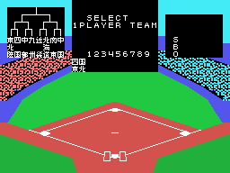
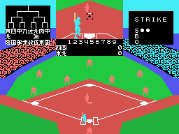
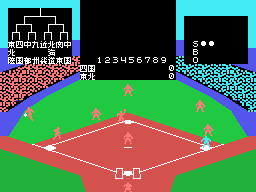
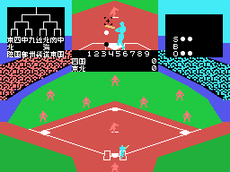
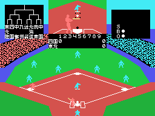

# The plays

A game against the computer, recorded in openMSX with the keyboard: the space bar every
30 frames and a different direction every 50 (`tools/guiones/partida.tcl`).

## The pitch

With each new batter, the window in the middle shows the pitch **close up**: the field
seen from behind the pitcher (0x948A), with the ball coming closer and growing. On the
field, the same ball comes down towards home plate with its shadow.

## The hit

The hit ball flies with its height and its shadow, bounces and slows down (`bateada`,
0x9E98), and the fielder whose turn it is goes for it while the batter runs to first.

## SAFE and OUT

The one who catches the ball throws to a base; if it gets there before the runner, OUT;
if not, SAFE.

## CHANGE

Three outs: CHANGE, the teams swap sides and the fielders' colours become the other
team's.

## A run

The runner who reaches home is written in the inning's box on the scoreboard (`carreras`,
0x91EC), and each team's total at the end of its row.
