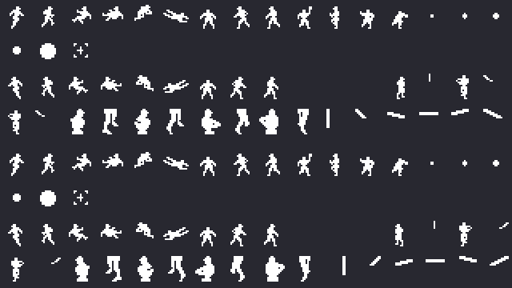
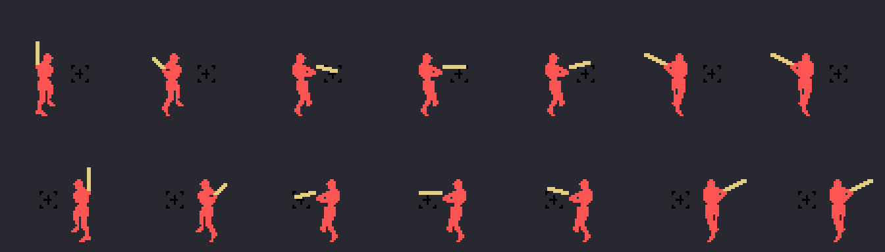
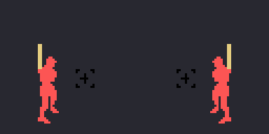

# The sprites

Everything on this page is **put together from the ROM tables** with `tools/hojas.py`: the drawings loaded the way
the game loads them and the batter built from its own tables. None of these images is a screenshot.

**Checked against openMSX** on the recordings of this site: the sprite drawing table built here (VRAM
0x3800-0x3FFF) is **identical** to the game's on 9,210 frames with a right-handed batter and on 2,712 with a
left-handed one, and the drawings and colours of the batter's six sprites match the game's (0xE1AC) on **5,989
frames, 0 different**, at the swing frame the RAM holds.

## The drawings

`sprites_carga` (0xAA1E) puts 0x260 bytes (0xAA35) at 0x3800 and, at 0x3C00, nine of them **flipped sideways**
(`gira_bloque`, 0x9E7F: each 16-byte half with its bits reversed, `gira_byte` 0xACA1, and the two halves swapped). As
each batter comes up, `bateador_pone` (0x9A9E) puts his 0x280 bytes (0x9B1C) at 0x3D80: as they are for a
right-hander and flipped for a left-hander (`zurdos`, 0x8777, says which of each team's nine are). So the
left-hander takes no room in the ROM. Above, with the right-hander; below, with the left-hander:

## The batter

Six sprites with their place on the screen (0x9AEC the right-hander, 0x9B04 the left-hander): the bat, two for the
body, the marker for the bat height (0xE1B8: up or down with the controller, `bateador_altura`) and two for the legs; three take the colour of the batting team (0xE020; here, a red).
The swing changes the drawings by stretches of the frame count (`tabla_busca`, 0xACF0): the body (0x9E60), the bat
(0x9E69) and the legs (0x9E76), and moves the bat at frames 5, 10 and 22 (the other way for the left-hander). On the
sheet, frames 0, 5, 10, 14, 18, 22 and 27:

And the whole swing, frame by frame, at 60 a second like the game:

