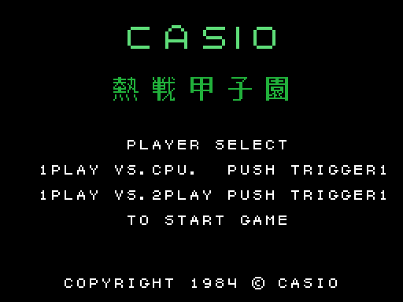
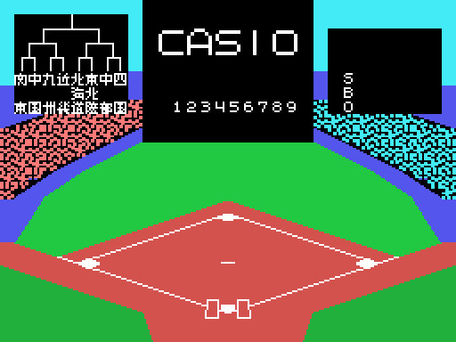

# The tournament

## The selection

The game starts in SCREEN 1, with the BIOS font: CASIO, the Japanese title (*Nessen
Koushien*), PLAYER SELECT and the two options, one against the computer or two players
(`elige_jugadores`, 0x81FD). A blinking arrow marks the option and the button picks it.
**There is no demo**: without touching anything, the game stays on this screen.

This screen and the next ones come from **running the ROM** with `tools/pantallas.py`
(the Z80 of `tools/z80run.py` with the BIOS routines the game uses, written by hand in
`tools/bios.py`). Checked against openMSX's VRAM: the selection matches except for the
arrow, which blinks; the field, except for the tournament bracket, which is drawn at
random.

## The bracket of the eight regions

Once chosen, the game switches to SCREEN 2 with the field. Top left is the **tournament
bracket**: eight regions of Japan, each in three kanji tiles (0xBA41), paired two by two
over three rounds (`torneo`, 0xB85C). The **strength** of each region is drawn at random
at the start, from a seed taken from the R register (`torneo_fuerza`, 0xB8C4), so the
bracket changes every game.

Then SELECT 1PLAYER TEAM: the player picks with the joystick the region he plays with,
which blinks in the bracket (`elige_equipo_bucle`, 0x8257), and his rival is the one next
to it (`torneo_jugador`, 0xB911).

## Winning the tournament

At the end of each game, `torneo_resultado` (0xBA81) settles the round: the player's game
counts by its runs, and **the others are decided by the strength** of each region
(`torneo_ganador`, 0xBB09); the lines of the losers are erased from the bracket.

Against the computer:

- if the player loses or ties, GAME OVER and, after a few seconds, the start;
- if he wins, NEXT GAME and the next round;
- after **three wins**, GAME CLEAR with its tune (`torneo_ganado`, 0x81BE).

Between two players, each game leads to the next until the bracket is complete.
