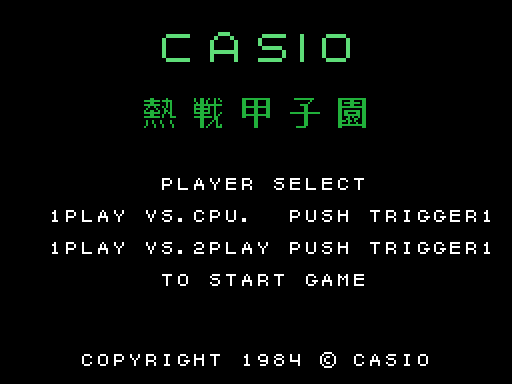
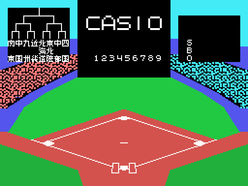

# El torneo

## La selección

El juego empieza en SCREEN 1, con la fuente de la BIOS: CASIO, el título japonés
(*Nessen Koushien*), PLAYER SELECT y las dos opciones, uno contra el ordenador o dos
jugadores (`elige_jugadores`, 0x81FD). Una flecha parpadeante marca la opción y el
botón la elige. **No hay demo**: sin tocar nada, el juego se queda en esta pantalla.

Esta pantalla y las siguientes salen de **ejecutar la ROM** con `tools/pantallas.py`
(el Z80 de `tools/z80run.py` con las rutinas de la BIOS que usa el juego, hechas a
mano en `tools/bios.py`). Cotejadas con la VRAM de openMSX: la selección casa salvo
la flecha, que parpadea; el campo, salvo el cuadro del torneo, que se sortea.

## El cuadro de las ocho regiones

Al elegir, el juego pasa a SCREEN 2 con el campo. Arriba a la izquierda está el
**cuadro del torneo**: ocho regiones de Japón, cada una en tres casillas de kanji
(0xBA41), emparejadas de dos en dos en tres rondas (`torneo`, 0xB85C). La **fuerza**
de cada región sale al azar al empezar, de una semilla tomada del registro R
(`torneo_fuerza`, 0xB8C4), así que el cuadro cambia en cada partida.

Después, SELECT 1PLAYER TEAM: el jugador elige con el mando la región con la que
juega, que parpadea en el cuadro (`elige_equipo_bucle`, 0x8257), y su rival es la de
al lado (`torneo_jugador`, 0xB911).

## Ganar el torneo

Al acabar cada partida, `torneo_resultado` (0xBA81) resuelve la ronda: la partida del
jugador cuenta por sus carreras, y **las demás se deciden por la fuerza** de cada
región (`torneo_ganador`, 0xBB09); las líneas de los que pierden se borran del cuadro.

Jugando contra el ordenador:

- si el jugador pierde o empata, GAME OVER y, tras unos segundos, el principio;
- si gana, NEXT GAME y la ronda siguiente;
- tras **tres victorias**, GAME CLEAR con su música (`torneo_ganado`, 0x81BE).

Entre dos jugadores, cada partida lleva a la siguiente hasta completar el cuadro.
