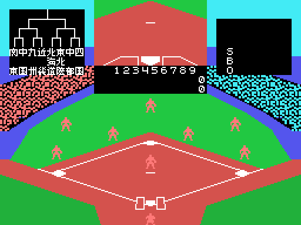

# La partida

*Exciting Baseball* es el torneo de béisbol de los institutos japoneses (el título
japonés, *Nessen Koushien*, es «el combate de Koshien»). Se juega contra el
ordenador o entre dos, y la pantalla es el campo visto desde detrás del bateador:
arriba a la izquierda, el cuadro del torneo; en el centro, una **ventana** con el
lanzamiento visto de cerca o los carteles; a la derecha, la cuenta de strikes,
bolas y outs. El torneo está en [El torneo](EL-TORNEO.html), y una partida entera en
[Las jugadas](LAS-JUGADAS.html).

Todos los GIF de esta web son la ROM **funcionando en openMSX** (un MSX1 japonés, a
60 cuadros por segundo): en cada cuadro se apuntan la VRAM y los registros del VDP, y
`tools/vdp.py` los pinta.

## Los mandos

Cada jugador tiene una dirección y **dos botones** (`mandos`, 0xA8C8):

| | dirección | botón 1 | botón 2 |
|---|---|---|---|
| jugador 1 | los cursores o el mando 1 | RETURN o el botón 1 del mando | BS o el botón 2 |
| jugador 2 | E, S, D y X o el mando 2 | CTRL o el botón 1 del mando | TAB o el botón 2 |

Jugando contra el ordenador, la barra y GRAPH son también los botones del jugador 1, y las
teclas del segundo valen para el primero. Las diagonales se quedan en una sola
dirección (`diagonales`, 0x8375).

## El lanzador

Antes de lanzar, el lanzador se mueve a los lados con su mando, de X 0x74 a 0x7C
(`lanzador_mueve`, 0x972A). El botón 1 lanza; el botón 2 con una dirección lanza a
esa **base**, para pillar a un corredor que se ha separado (`tiro_base`, 0x9917).
Mientras la pelota vuela hacia el bateador, el mando del que lanza le da **efecto**:
arriba, abajo, a un lado o al otro, a partir de la mitad del camino (`pelota_vuela`,
0x983D).

## El bateador

El bateador se mueve adelante y atrás en la caja y sube o baja el bate con su mando;
el botón empieza el **swing** (`bateador_swing`, 0x9D9C). Lo que pasa lo decide el
cuadro del swing (0xE016) cuando la pelota llega a la zona de bateo (`bateo`,
0x885B):

| cuadro del swing | qué pasa |
|---|---|
| antes del 10, con el bate quieto | **toque**: la pelota cae corta delante (`toque`, 0x8921) |
| del 10 al 12 | golpe **temprano** |
| del 13 al 17 | golpe **a tiempo** |
| del 18 al 21 | golpe **tarde** |

La dirección del golpe sale de ese momento y de la parte del bate que toca la pelota
(cuatro tramos): doce direcciones (0xA011). Si el bate se ha
movido y no toca, es strike; si la pelota pasa por la zona sin swing, también.

## La cuenta

Tres strikes, out; cuatro bolas, el bateador va a primera y los que estén obligados
avanzan (`base_por_bolas`, 0xA205). Tres outs, CHANGE y el otro equipo batea
(`outs`, 0x9131). Los carteles BALL, STRIKE, FOUL, OUT, SAFE y CHANGE salen en la
ventana con su sonido.

## Los corredores

El que batea manda a sus corredores con el botón y una dirección: derecha el de
primera, arriba el de segunda, izquierda el de tercera. Con el botón 2 antes del
lanzamiento, **roban** base (`robo`, 0x88D6); con la pelota en el campo, avanzan o
vuelven (`corredores_ordenes`, 0xA029). Cada corredor va de base en base por su
camino, con sus pasos (`corredor`, 0xB3B8).

## La defensa

Los nueve jugadores de la defensa **no son sprites sino casillas**, de 2 x 2, en sus
sitios del campo (`defensa_pinta`, 0x8F6F). Cuando uno sale a por la pelota, su sitio
se borra y pasa a ser un sprite que corre (`campo`, 0xA2E0). El que la coge elige con
su mando la base a la que tirar (una marca parpadea en ella) y lanza con el botón
(`tiro`, 0xA5C4).

## El ordenador

El ordenador juega **con el segundo mando**: en cada fase escribe en 0xE08E la
dirección y los botones que pulsaría un jugador (`ordenador`, 0x94DE). Lanza con
efecto al azar, batea moviendo el bate hacia la pelota, roba al azar y en la defensa
tira a la base que hace falta.

## Las entradas

Nueve entradas. Si en la novena el que batea segundo ya va ganando, no batea: en el
marcador sale una **X** (0x9382). No hay entradas extra: la partida se acaba al final
de la novena, y contra el ordenador **el empate cuenta como derrota** (`fin_partida`,
0x8125). Si un equipo llega a 100 carreras, la partida se acaba también.
