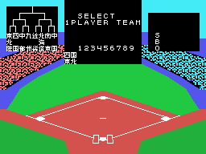
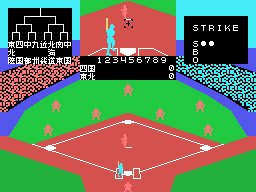
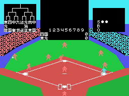
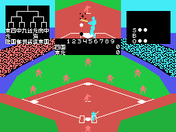
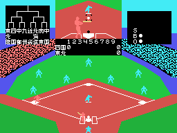

# Las jugadas

Una partida contra el ordenador, grabada en openMSX con el mando: la barra cada 30
cuadros y una dirección distinta cada 50 (`tools/guiones/partida.tcl`).

## El lanzamiento

Con cada bateador nuevo, la ventana del centro enseña el lanzamiento **de cerca**: el
campo visto desde detrás del lanzador (0x948A), con la pelota que se acerca y crece. En
el campo, la misma pelota baja hacia la casa con su sombra.

## El bateo

La pelota bateada vuela con su altura y su sombra, bota y pierde velocidad
(`bateada`, 0x9E98), y el jugador de la defensa que toca sale a por ella mientras el
bateador corre a primera.

## SAFE y OUT

El que coge la pelota tira a una base; si llega antes que el corredor, OUT; si no,
SAFE.

## CHANGE

Tres outs: CHANGE, los equipos cambian de campo y los colores de la defensa pasan a
ser los del otro equipo.

## Una carrera

El corredor que llega a casa se apunta en la casilla de la entrada del marcador
(`carreras`, 0x91EC), y la suma de cada equipo, al final de su fila.
