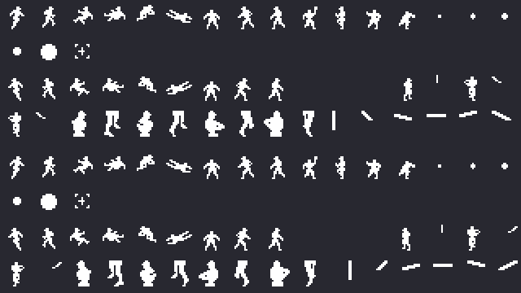
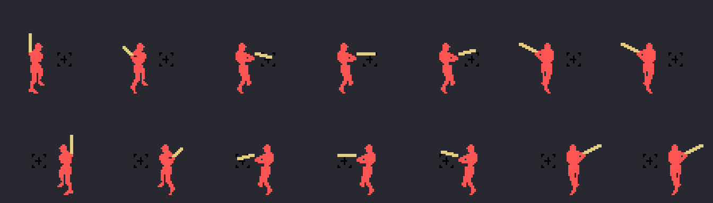
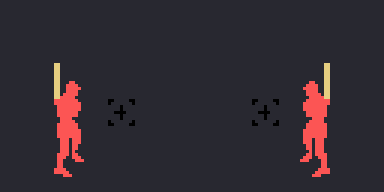

# Los sprites

Todo lo de esta p&aacute;gina est&aacute; **montado desde las tablas de la ROM** con `tools/hojas.py`: los dibujos
cargados como los carga el juego y el bateador compuesto con sus propias tablas. Ninguna imagen es una captura.

**Cotejado con openMSX** en las grabaciones de la web: la tabla de dibujos de los sprites (VRAM 0x3800-0x3FFF) que se
monta aqu&iacute; es **id&eacute;ntica** a la del juego en 9.210 cuadros con un bateador diestro y en 2.712 con uno
zurdo, y los dibujos y colores de los seis sprites del bateador casan con los del juego (0xE1AC) en **5.989 cuadros,
0 distintos**, en el cuadro del swing que dice la RAM.

## Los dibujos

`sprites_carga` (0xAA1E) pone 0x260 bytes (0xAA35) en 0x3800 y, en 0x3C00, nueve de ellos **girados de lado**
(`gira_bloque`, 0x9E7F: cada mitad de 16 bytes con los bits al rev&eacute;s, `gira_byte` 0xACA1, y las dos mitades
cambiadas). Al salir cada bateador, `bateador_pone` (0x9A9E) pone sus 0x280 bytes (0x9B1C) en 0x3D80: tal cual si es
diestro y girados si es zurdo (`zurdos`, 0x8777, dice cu&aacute;les de los nueve de cada equipo lo son). As&iacute; el
zurdo no ocupa sitio en la ROM. Arriba, con el diestro; abajo, con el zurdo:

## El bateador

Seis sprites con su sitio en la pantalla (0x9AEC el diestro, 0x9B04 el zurdo): el bate, dos del cuerpo, la
marca de la altura del bate (0xE1B8: arriba o abajo con el mando, `bateador_altura`) y dos de las piernas; tres llevan el color del equipo que batea (0xE020; aqu&iacute;, un
rojo). El swing cambia los dibujos por tramos del cuadro (`tabla_busca`, 0xACF0): el cuerpo (0x9E60), el bate
(0x9E69) y las piernas (0x9E76), y mueve el bate en los cuadros 5, 10 y 22 (al rev&eacute;s en el zurdo). En la hoja,
los cuadros 0, 5, 10, 14, 18, 22 y 27:

Y el swing entero, cuadro a cuadro, a 60 por segundo como el juego:

